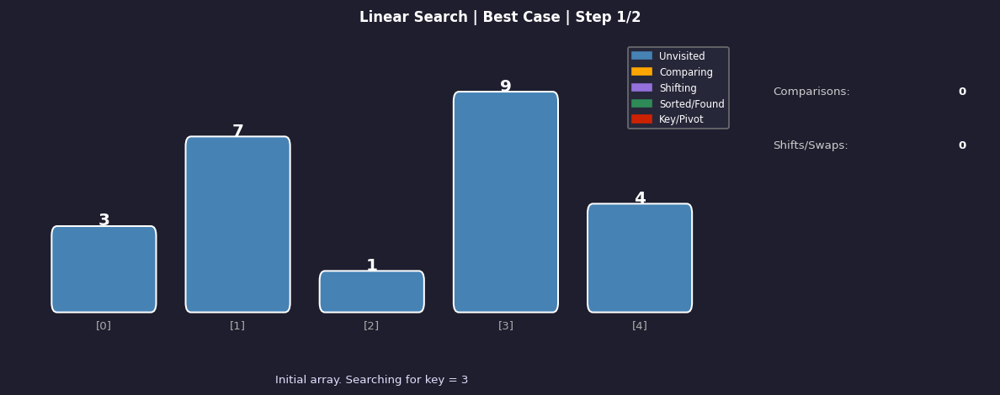
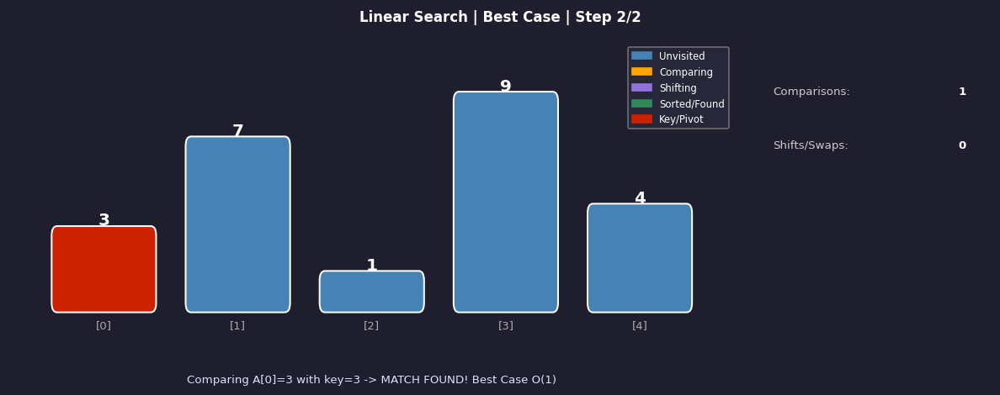
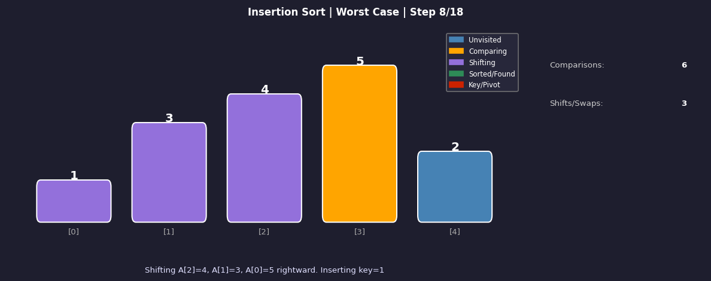
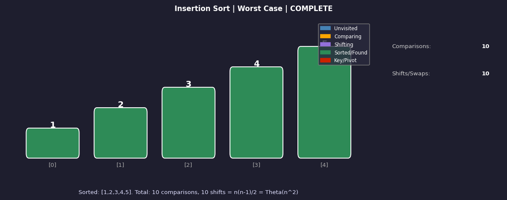

# 📊 Best, Worst and Average Case Analysis
### DAA Assignment — UPES, School of Computer Science

> **Student:** Sparsh Srivastava &nbsp;|&nbsp; **SAP ID:** 590022251 &nbsp;|&nbsp; **Batch:** B17 &nbsp;|&nbsp; **Sem III** &nbsp;|&nbsp; **Course:** CSEG3053

---

## 🎬 Animation Preview

| Frame 1 — Initial Array | Frame 2 — Key Found (Best Case) |
|:---:|:---:|
|  |  |

| Frame 3 — Shifting (Insertion Sort) | Frame 4 — Sorted Complete |
|:---:|:---:|
|  |  |

---

## 📁 Repository Structure

```
daa-case-analysis/
│
├── animation.py          ← Interactive step-by-step animation
├── requirements.txt      ← Python dependencies
├── report.tex            ← LaTeX report (upload to Overleaf)
├── references.bib        ← BibTeX references
├── figures/
│   ├── frame1.png        ← Animation screenshot 1
│   ├── frame2.png        ← Animation screenshot 2
│   ├── frame3.png        ← Animation screenshot 3
│   └── frame4.png        ← Animation screenshot 4
└── README.md             ← This file
```

---

## 🚀 How to Run the Animation

### Step 1 — Clone the repository
```bash
git clone https://github.com/YOUR_USERNAME/daa-case-analysis.git
cd daa-case-analysis
```

### Step 2 — Install dependencies
```bash
pip install -r requirements.txt
```

### Step 3 — Run
```bash
python animation.py
```

---

## 🎮 Controls

| Button | Action |
|--------|--------|
| **◀ Prev** | Go to the previous step |
| **Next ▶** | Go to the next step |
| **⟳ Reset** | Restart from step 1 |
| **Best / Avg / Worst** | Switch input scenario |
| **Linear Search / Insertion Sort** | Switch algorithm |

---

## 📊 What the Animation Demonstrates

### Linear Search on `[3, 7, 1, 9, 4]`

| Case | Key | Steps | Complexity |
|------|-----|-------|------------|
| **Best** | `3` | Found at index 0 → 1 comparison | `O(1)` |
| **Average** | `9` | Found at index 3 → 4 comparisons | `O(n)` |
| **Worst** | `5` | Not found → 5 comparisons | `O(n)` |

### Insertion Sort

| Case | Input | Shifts | Complexity |
|------|-------|--------|------------|
| **Best** | `[1, 2, 3, 4, 5]` | 0 shifts | `O(n)` |
| **Average** | `[3, 1, 4, 5, 2]` | 8 shifts | `O(n²)` |
| **Worst** | `[5, 4, 3, 2, 1]` | 10 shifts | `O(n²)` |

---

## 📐 Key Concepts Covered

- **Best Case** — $T_{\min}(n) = \min_{I \in \mathcal{I}_n} T(I)$
- **Worst Case** — $T_{\max}(n) = \max_{I \in \mathcal{I}_n} T(I)$
- **Average Case** — $T_{\text{avg}}(n) = \sum P(I) \cdot T(I)$
- **Inversion Analysis** for Insertion Sort: expected inversions $= \frac{n(n-1)}{4}$
- **Master Theorem** for Quick Sort best case: $T(n) = 2T(n/2) + \Theta(n) \Rightarrow \Theta(n \log n)$

---

## 🛠️ Dependencies

```
matplotlib >= 3.7.0
numpy >= 1.24.0
```

---

## 📄 Report

The LaTeX report (`report.tex` + `references.bib`) is compiled on [Overleaf](https://overleaf.com).  
Upload `report.tex` and `references.bib` together as a new Overleaf project.

---

## 📚 References

1. Cormen, Leiserson, Rivest, Stein — *Introduction to Algorithms*, 4th ed., MIT Press, 2022
2. Kleinberg, Tardos — *Algorithm Design*, Pearson, 2006
3. Sedgewick, Wayne — *Algorithms*, 4th ed., Addison-Wesley, 2011
4. Knuth — *The Art of Computer Programming Vol. 3*, 2nd ed., Addison-Wesley, 1998

---

## ⚠️ AI Declaration

AI tools (Google Antigravity) were used for structural scaffolding (~15%).  
All mathematical derivations, proofs, algorithm traces, TikZ figures, and animation code were authored by the student.
